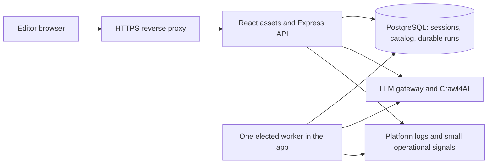

# Architecture and deployment review — 15 October 2026

Applied the Agency Software Architect and DevOps Automator profiles to the current source. This is a source review, not a production certification. The main review coordinates build, dependency, database and browser verification; this lane did not repeat those runs, access `.env`, contact paid providers, or change application code.

The modular monolith is appropriate for this app. Preserve its Express routes, PostgreSQL persistence, server-owned provider credentials, and durable job runner. The release work is to make this design reproducible, observable, and bounded. A service rewrite would add operational work without repairing the issues below.

## Confirmed findings

Severity describes the consequence under the stated condition. A missing release gate is not evidence of an observed production incident. Security vulnerabilities and UI findings are recorded in the companion reviews.

### AD-01 — Medium: runtime and declared schemas disagree about durable retry state

**Evidence:** [jobRunner.ts](../../src/server/jobRunner.ts):65 adds `job_run_items.provider_state` at startup; lines 348–365 save the attempted model and last retryable failure there. [schema.ts](../../src/db/schema.ts):110–115 declares the same table without this column. [database.ts](../../src/server/database.ts):73–87 checks selected columns but never verifies `provider_state`. [package.json](../../package.json):18–20 exposes both schema generation and `db:push`; no migration files are tracked under `drizzle/`.

**Condition and impact:** a developer runs schema reconciliation against an initialized database using the advertised Drizzle schema. The undeclared column can be proposed for removal. Approving that operation discards the failure information used to choose the remaining fallback attempt after a restart. Against a running server, subsequent retry-state updates fail. Startup can recreate the column, but it cannot reconstruct deleted state. Saved item results and the separate attempt count are not stored in this column. The consequence depends on an operator accepting destructive reconciliation; no automatic deletion or remotely reachable exploit was demonstrated. This review did not execute a destructive schema push.

**Smallest fix:** add `providerState` to the existing Drizzle table, include it in schema verification, and capture the actual initial schema and subsequent changes as reviewed migrations. Run migrations once before starting the app; eventually give the ordinary runtime role data privileges without schema-alteration privileges. Keep the current domain tables and job model.

**Acceptance check:** initialize a disposable database, record a failed attempt with a fallback eligible state, reconcile/migrate it without a destructive proposal, restart, and verify that only the remaining attempt uses the saved fallback. Test an upgrade from the previous release as well as a fresh install.

### AD-02 — High release gate: consequential integration tests are outside the default release path

**Evidence:** [package.json](../../package.json):25,28,30–32 defines separate database/browser commands while `npm test` runs only the fast suite. [jobRunner.test.ts](../../src/server/jobRunner.test.ts):5–37 uses a stub connection to test transaction retries. The real two-worker, restart, result-save and cancellation checks are instead in [security.test.ts](../../src/server/security.test.ts):354–427; it requires a disposable `TEST_DATABASE_URL` at line 24. Neither `.github/` workflows nor a migration directory are tracked in the reviewed checkout. [Dockerfile](../../Dockerfile):19–29 builds and installs dependencies without executing the test suites.

**Condition and impact:** a change passes the normal test/build commands and is released without the separate checks. It has not demonstrated that authentication, actual PostgreSQL locking, result persistence, schema upgrades, or the browser flows work together. A passing `test:job-runner` alone does not validate the live worker.

**Smallest fix:** one checked-in CI workflow using the existing scripts: clean install, fast tests, disposable PostgreSQL integration/configuration tests, existing browser tests, and production image build/smoke. Keep live paid-provider checks separate and explicit. Build one immutable image tagged with the commit and promote that artifact, rather than rebuilding separately for production.

**Acceptance check:** deliberately break a real database constraint or two-worker guarantee and confirm CI rejects the change. Then pass the complete workflow on an empty database and an upgraded fixture, boot the production image, and verify HTTPS login, authenticated catalog access, cancellation, restart recovery and one export through the intended reverse proxy. Retain the image digest and test results.

### AD-03 — High deployment constraint: transaction-pooled database connections cannot own this worker lock

**Evidence:** [jobRunner.ts](../../src/server/jobRunner.ts):403–438 holds `pg_try_advisory_lock` on a dedicated client across many transactions and external requests. [index.ts](../../src/db/index.ts):16–36 accepts PostgreSQL connection strings, including pooler hosts, without verifying session affinity.

**Condition and impact:** deploy with a transaction-mode connection pooler. The worker assumes that the database session holding its lock remains attached to the same client; transaction pooling explicitly does not support session advisory locks. Ownership and unlock operations can run against different backend sessions, invalidating the single-worker safety assumption. This is a deployment incompatibility, not proof that the current environment uses that mode. [PgBouncer documents this incompatibility](https://www.pgbouncer.org/features.html); [PostgreSQL describes the session lifetime of advisory locks](https://www.postgresql.org/docs/current/explicit-locking.html#ADVISORY-LOCKS).

**Smallest fix:** require a direct PostgreSQL or session-mode endpoint for the current app/worker and put that requirement in deployment validation. Do not replace the job system merely to support a different pooler mode. If transaction pooling becomes mandatory, change ownership to a properly tested durable lease/fencing protocol or give the worker a separate direct connection.

**Acceptance check:** verify the actual provider connection mode, not a guessed port number; start two production processes against the selected endpoint and prove that only one dispatches each item, then terminate the owner and demonstrate takeover. Also prove no old owner can commit after takeover.

### AD-04 — Medium: two-second polling scales with total stored data and job count

**Evidence:** [JobsModule.tsx](../../src/components/JobsModule.tsx):85–97 loads every displayed job's entire run history, fetches full run details, and refreshes the catalog/jobs every two seconds. Catalog mode fetches the latest run even after it finishes; lines 103–115 also poll a selected finished run indefinitely. [useCatalogData.ts](../../src/hooks/useCatalogData.ts):54–65 retrieves the full catalog. [catalog.ts](../../src/server/catalog.ts):116 returns every SKU including evidence/result fields; lines 235–237 returns every job. [jobRunner.ts](../../src/server/jobRunner.ts):81–93 returns all item snapshots/results and lines 186–189 returns unpaginated history.

**Condition and impact:** keep a Jobs tab open as jobs, evidence and history accumulate. For `J` jobs and `D` detail requests, each completed polling cycle makes `J + D + 2` application requests, plus another request when a run is selected. Each request also performs session lookup. Full evidence and export-ready data are repeatedly queried, serialized, transferred and parsed. The existing `busy` flag prevents overlapping cycles within one effect, but does not bound the amount fetched or stop polling terminal data. Multiple viewers multiply this cost.

**Smallest fix:** stop polling completed details; poll only active run summaries and reload full results on completion or explicit viewing/export. Refresh catalog rows only when their run changes. Then paginate job/history/catalog lists and load large evidence on demand when measured data warrants it. Preserve historical export snapshots.

**Acceptance check:** with completed jobs and no active selection, repeated timer ticks must make no full-result/catalog requests. With an active run, request count and response bytes should depend on the visible active page, not all stored jobs. Test with representative large evidence and history, multiple viewers and the configured 1.5 GiB container limit; record latency, bytes, browser responsiveness and peak memory before setting a supported capacity.

### AD-05 — Medium: schema health can remain green while the only worker makes no progress

**Evidence:** [server.ts](../../server.ts):30–33 reports ready solely from `verifySchema`. That function performs approximately 17 schema queries per call ([database.ts](../../src/server/database.ts):73–87). Worker errors at [jobRunner.ts](../../src/server/jobRunner.ts):426–427 emit a generic message; paid-result persistence at lines 389–397 retries until ownership/cancellation stops it. No heartbeat, queue-age signal, request correlation, or worker progress metric is exposed by these paths. [compose.yaml](../../compose.yaml):18–27 checks only `/healthz` and rotates local stdout/stderr logs.

**Condition and impact:** a permanently failing result save or worker-specific error leaves queued work waiting, while schema checks succeed. Operators cannot distinguish idle work, normal provider latency and a stuck worker from the health response. A retry-until-recovery strategy appropriately protects a paid response, but it needs a visible stall signal. Generic API failures in [server.ts](../../server.ts):46–50 are also returned without a corresponding diagnostic log.

**Smallest fix:** retain response-save retry behavior, add structured event logs with request/run/item identifiers and safe error codes, and expose last worker progress/oldest queued age. Alert on queue age and stalled active work; use a cheap bounded database readiness probe and perform detailed schema verification at startup. Keep provider credentials and complete product evidence out of logs. A single process and platform log collection are sufficient initially.

**Acceptance check:** inject a persistent save failure and a database outage independently. Confirm an operator receives a useful stalled-work/unavailable signal and can identify the affected run without seeing secrets. Restore service and confirm the preserved response commits without another provider request. Do not report the single instance unhealthy simply because a second instance correctly holds the worker lock.

### AD-06 — Medium: shutdown closes the pool before all HTTP work has drained

**Evidence:** [server.ts](../../server.ts):79–85 calls `listener.close()` without waiting for its completion, stops the worker, and then ends the database pool. A request may be outside a database transaction during an external scrape ([catalog.ts](../../src/server/catalog.ts):180–208), and require a new transaction later to save its result. [compose.yaml](../../compose.yaml) supplies no explicit `stop_grace_period`; Docker Compose defaults to ten seconds, while pool queries/acquisition can wait fifteen seconds ([index.ts](../../src/db/index.ts):33–36). [Docker documents the stop grace period](https://docs.docker.com/reference/compose-file/services/#stop_grace_period).

**Condition and impact:** deployment sends SIGTERM during an active HTTP scrape or a slow worker database operation. The active request can reach persistence after `pool.end()` and fail to save collected evidence; a slower shutdown can be killed before finishing. The worker's durable state permits later recovery within the remaining attempt/deadline budget, but external requests can already have been charged. A zero-interruption rollout has not been established.

**Smallest fix:** stop admitting new HTTP work, abort/drain long requests under a documented deadline, await server close, and close the pool after request/worker cleanup. Handle shutdown rejection and set a measured container grace period longer than the cleanup deadline. If aborting active provider requests is the chosen policy, make its cost/retry behavior explicit; do not claim exactly-once provider billing.

**Acceptance check:** send SIGTERM during a mock slow HTTP scrape, an in-flight model response, a result-save retry and a database outage. Verify bounded process exit, no transaction uses an ended pool, committed results remain intact, and a replacement worker cannot duplicate already committed items. Test the actual container stop command, not only an in-process worker stop function.

## Target architecture decision

**Proposed decision:** keep a single deployable modular monolith with one active PostgreSQL-backed worker. React serves the editorial flows; Express owns authentication and use cases; PostgreSQL owns sessions, revisions, snapshots and queued work; the current provider/scraper adapters own external calls. Route handlers can remain simple transaction scripts. Share API DTOs deliberately when changing an endpoint instead of importing UI hook types into server files.

| Option | When to choose it | Trade-off |
| --- | --- | --- |
| Keep the current API and worker process | First controlled release and a small editorial team | Least deployment work; HTTP and job processing share memory and lifecycle, and jobs execute serially. |
| Run the same worker module in a separate process | Measured HTTP latency/memory contention or a need to deploy UI/API without interrupting jobs | Adds a process, connection budget and release coordination. Keep PostgreSQL job ownership; add distributed admission before increasing concurrency. |

Do not add Redis, Kubernetes, microservices, CQRS, or a new workflow framework to clear these gates. They do not correct schema drift, excessive reads, missing validation or shutdown ordering.

## Existing strengths and capacity limits

- Run starts have a durable `(job_id, request_id)` uniqueness constraint and one-active-run index; worker ownership is fenced by an owner token and PostgreSQL lock. Input/evidence revisions prevent stale work overwriting newer catalog evidence ([jobRunner.ts](../../src/server/jobRunner.ts):43–69,113–175,223–245).
- Provider attempts are recorded before dispatch; retries and the five-minute item budget survive a restart. Saving an already obtained response retries the database commit rather than paying for another request ([jobRunner.ts](../../src/server/jobRunner.ts):294–302,349–365,389–397). This is useful protection, not exactly-once billing across a crash between provider completion and durable save.
- The production image runs as `node`, uses locked dependency installation and omits development packages. Compose binds the app to loopback, has an init process, resource limits and log rotation. `.dockerignore` excludes local credentials and development caches. Production retrieval is cloud based; Chromium need not be added to the runtime image because browser tests use it.
- One elected worker processes one whole run at a time ([jobRunner.ts](../../src/server/jobRunner.ts):270–282,415–424). Adding API replicas does not increase job throughput. A long run delays every later run. The database pool is ten connections **per process**, including one dedicated worker connection.
- Imports accept up to 10,000 rows and issue one insert per row inside the global mutation lock ([catalog.ts](../../src/server/catalog.ts):23–25,119–130; [database.ts](../../src/server/database.ts):3–16). That is an input limit, not tested operating capacity. On a distant database, row round trips can hold that lock long enough to delay worker saves and edits. Measure first; use bounded multi-row inserts if import latency/lock waits require it, preserving atomic validation and duplicate handling.
- Scraper admission allows one retrieval and eight waiting requests **per process** ([cloudScrape.ts](../../src/lib/cloudScrape.ts):22–50). Model cleanup runs after retrieval releases that slot ([scrapePipeline.ts](../../src/server/scrapePipeline.ts):108–111), with a separate two-active/eight-waiting provider admission limit ([chatCompletion.ts](../../src/lib/chatCompletion.ts):21–50). More replicas multiply these limits; login throttling is also process local. Start with one app instance and gateway limits.
- Data/history retention, backup restoration and a maximum supported workspace size have not been demonstrated by this review. Never delete run snapshots merely to reduce payloads; current exports depend on them.

## Staged deployment gates

1. **Before staging:** resolve the security review's release blockers, reconcile schemas, add the complete CI gate, choose the actual hosting target and database connection mode. Define the expected editor count, evidence size, job size, retention and spend limits. Reject missing production origin/credentials without printing secret values.
2. **Disposable staging:** use the production image and intended HTTPS proxy with a fresh database, then an upgraded copy of representative non-sensitive data. Run database/configuration/browser checks, session/role and origin checks, import → QA/Catalog → reviewed export, cancellation, two workers, crash recovery and SIGTERM checks. Capture results against a commit/image digest. Mocked providers are sufficient for deterministic failure tests; explicitly budget any later live-provider smoke test.
3. **Operations rehearsal:** restore a real staging backup into a new database and verify records, historical exports and account access; record recovery time and data-loss interval. Select encrypted managed backups/PITR or scheduled encrypted backups with a restore owner. Test a previous compatible image against the migrated schema. Set structured logs, external uptime checks, database/pool pressure, oldest queued age, worker progress and provider spend/rate-limit alerts. A Compose restart policy alone is not a rollback system.
4. **Controlled release:** run one app instance behind HTTPS, PostgreSQL direct/session connectivity, explicit origin, secrets managed on the host, and the tested resource limits. Promote the previously tested image. Run a short authenticated smoke test and verify queue progress; use the tested previous image as rollback only when schema compatible. Enable automatic traffic rollback only after its smoke criteria and schema compatibility are rehearsed.
5. **Broader rollout:** increase users/data only after measuring request bytes, p95 latency, database lock waits, queue delay, per-item execution time, browser memory and container peak memory. Fix completed-data polling before increasing capacity. Split worker deployment only when its independent lifecycle or resource isolation has a measured benefit.

No application changes or live deployment were made by this review. Production readiness remains conditional on the companion security fixes and execution of these gates; neither architecture review nor a passing build makes the app airtight.
